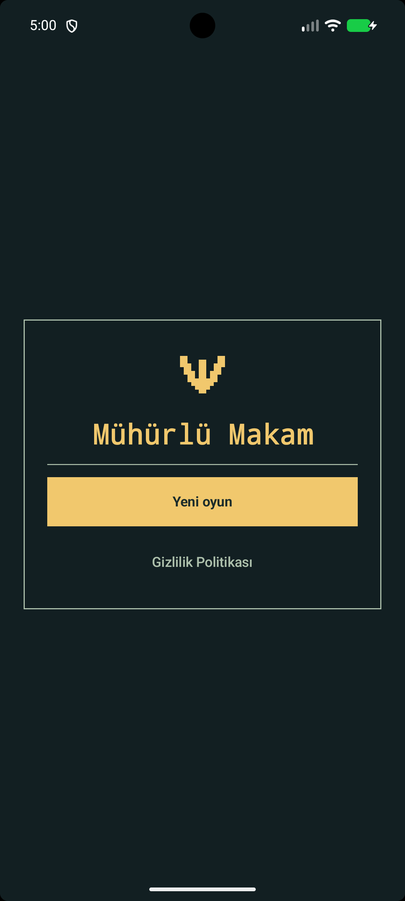
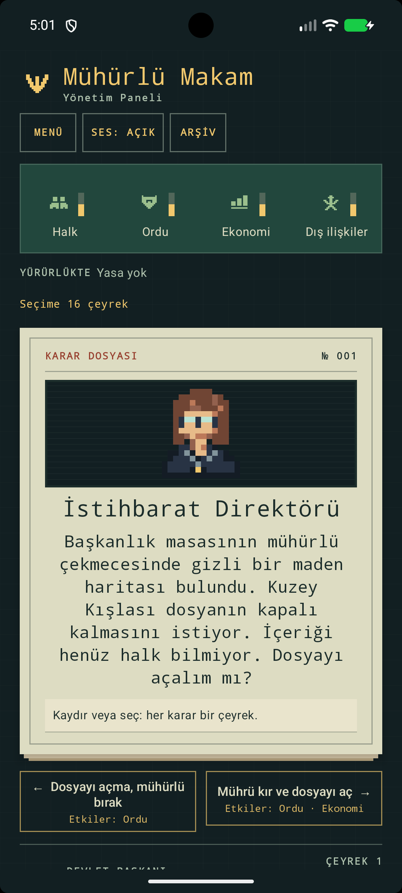
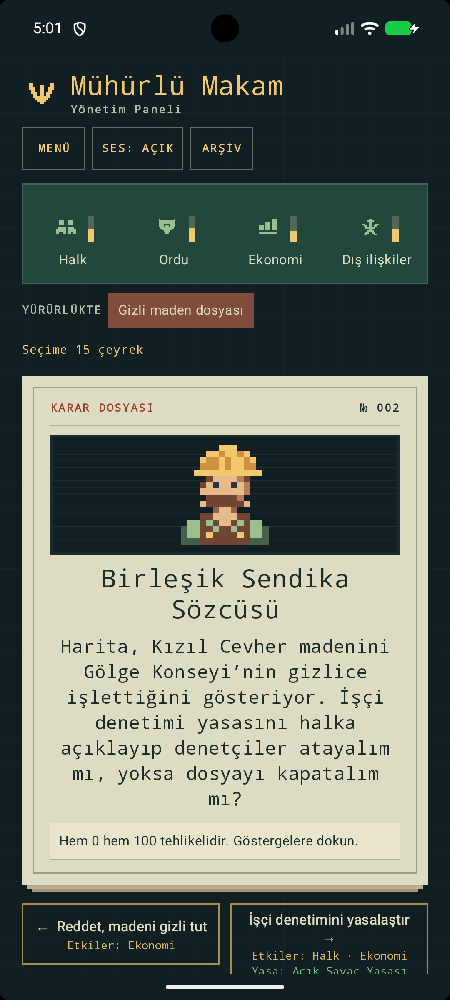

# Mühürlü Makam

> **1974, Valdoria Cumhuriyeti.** Başkanlık masasının mühürlü çekmecesinden çıkan gizli dosyalarla ülkenin kaderini belirleyen, tamamen çevrimdışı ve retro-fütüristik bir Türkçe politik karar oyunu.

---

## Oyun Hakkında

**Mühürlü Makam**, 1970'lerin daktilolar, tüplü ekranlar ve brütalist kamu yapılarıyla örülü kurgusal **Valdoria Cumhuriyeti** evreninde geçer. Oyuncu, her çeyrek yıl önüne gelen karar dosyalarını sağa veya sola kaydırarak dört kritik dengeyi yönetir: **Halk Desteği**, **Ordu**, **Ekonomi (Kred)** ve **Dış İlişkiler**.

- **İki uçlu risk dengesi:** Herhangi bir göstergenin `0` ya da `100` sınırına ulaşması dönemi sonlandırır; aşırı güç birikimi de en az çöküş kadar tehlikelidir.
- **Koşullu öykü zincirleri ve yasalar:** Alınan gizli kararlar sonraki çeyreklerde yeni dosyaları tetikler; çıkarılan yasalar yürürlükte kaldığı sürece her çeyrek göstergelere kalıcı etki uygular.
- **Halefiyet ve Bakanlık Arşivi:** Bir başkanlık dönemi sona erdiğinde zaman, yasalar ve olay işaretleri halefe devredilir. Geçmiş başkanlık dönemleri ve karar etkileri **Bakanlık Arşivi** üzerinden kronolojik olarak incelenebilir.

---

## Ekran Görüntüleri

| Ana Menü | Karar Dosyası | Öykü Zinciri ve Yasalar |
| :---: | :---: | :---: |
|  |  |  |

---

## Kullanılan Teknolojiler

| Katman | Teknolojiler ve Yaklaşımlar |
| :--- | :--- |
| **Android & Arayüz** | Kotlin, Jetpack Compose, Material 3, Compose `Canvas` (tam piksel katlı özel çizim), özel sürükleme/animasyon fiziği (`Animatable`, `pointerInput`) |
| **Mimari & Kalıcılık** | MVVM (`ViewModel`, `StateFlow`), Jetpack DataStore (Preferences), `kotlinx.serialization` |
| **Çapraz Doğrulama & Denge** | TypeScript, Node.js (`node:test`), Kotlin & TypeScript çift motor eşlenik testleri, 5 stratejili / 1.000 tohumlu Monte Carlo denge simülasyonu |
| **Ses & Görsel Tasarım** | 16×16 ve 24×24 piksel matrisleri ile prosedürel arayüz portreleri, programatik sentezlenmiş retro ses efektleri ve dinamik arka plan müzikleri |
| **Yayın & Gizlilik** | Android SDK 36 (minSdk 26), R8/ProGuard kod ve kaynak küçültme, sıfır ağ izni, reklam ve analitik içermeyen yerel kayıt mimarisi |

---

## Öne Çıkan Mühendislik Detayları

- **Dış Görsel Paketsiz Piksel Sanat Hattı:** Altı danışman portresi, beş başkan arketipi ve tüm durum/çöküş simgeleri dış bitmap dosyalarına bağlı olmadan, Compose `Canvas` üzerinde tam piksel katlarıyla çizilen 16×16 ve 24×24 matrisler olarak tasarlanmıştır.
- **Deterministik Çift Motor ve Denge Simülasyonu:** Android uygulamasındaki Kotlin oyun motoru, TypeScript ile yazılmış eşlenik bir motorla ortak senaryo paketleri üzerinden doğrulanır. Beş farklı oyun stratejisi (rastgele, tek yönlü, tam bilgili ve yaklaşık bilgili denge stratejileri) 1.000 başlangıç tohumuyla otomatik simüle edilerek kart dengesi ve erken çöküş oranları kontrol altında tutulur.
- **Gizlilik Odaklı Mimari:** Oyun tamamen çevrimdışı çalışır; ağ izni, hesap sistemi, üçüncü taraf SDK, reklam veya kullanım analitiği içermez. İlerleme ve tercihler yalnızca cihaz içinde saklanır.

---

## Bu Depo Hakkında (Portföy Kapsamı)

Uygulama şu anda **Google Play kapalı test** sürecinde olduğundan; tam oyun motoru, 72 kartlık senaryo destesi, piksel matrisleri, ses varlıkları ve yayın betikleri tescilli olarak özel tutulmaktadır.

Bu vitrin deposunda teknik mimariyi ve veri modellemesini incelemek isteyenler için şu örnek dosyalar paylaşılmıştır:

- [`app/src/main/java/game/makam/GameModels.kt`](app/src/main/java/game/makam/GameModels.kt) — Kotlin `kotlinx.serialization` veri modelleri, koşul eşleştirme ve karar/yasa etki hesaplama sözleşmeleri.
- [`app/src/main/java/game/makam/Chronology.kt`](app/src/main/java/game/makam/Chronology.kt) — Çeyrek takvimi ve başkanlık dönemi kronoloji modeli.
- [`types/game.ts`](types/game.ts) — Denge simülasyonu ve eşlenik doğrulama için kullanılan TypeScript veri sözleşmeleri.
- [`samples/cards.sample.json`](samples/cards.sample.json) — Koşullu dallanma, işaret (flag) takibi ve yasa yürürlüğünü gösteren 3 kartlık örnek zincir kesiti.

---

## Bağlantılar ve Telif Hakkı

- **Gizlilik Politikası:** [nuhmetehan.github.io/muhurlu-makam-game](https://nuhmetehan.github.io/muhurlu-makam-game/)
- **Geliştirici:** Numetivo
- **Lisans:** Tüm hakları saklıdır — ayrıntılar için [`LICENSE`](LICENSE) dosyasına bakın.
